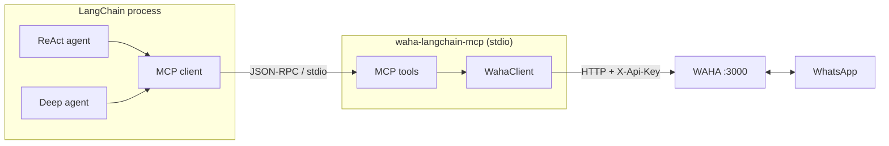

# waha-langchain-mcp

MCP server that exposes a local [WAHA](https://waha.devlike.pro/) (WhatsApp HTTP
API) instance as tools for LangChain ReAct agents and deep agents.



Full diagram: [`docs/architecture/waha-mcp.mmd`](docs/architecture/waha-mcp.mmd).
Design decision: [`docs/decisions/0001-mcp-server-for-waha.md`](docs/decisions/0001-mcp-server-for-waha.md).

## Tools

Sessions: `waha_status`, `waha_list_sessions`, `waha_get_session`, `waha_get_me`,
`waha_start_session`, `waha_stop_session`, `waha_create_session`.

Chats and messages: `waha_list_chats`, `waha_get_chat`,
`waha_get_chat_messages`, `waha_mark_chat_read`, `waha_set_typing`,
`waha_take_screenshot`.

Sending: `waha_send_text`, `waha_send_image`, `waha_send_file`.

Contacts: `waha_check_number_exists`, `waha_get_profile_picture`.

Inbound messages are not pushed over MCP. For that, point a WAHA webhook at your
application; MCP is request/response only.

## Setup

```bash
cd /home/user/Projects/aegra-content/waha-langchain-mcp
uv venv
uv pip install -e ".[examples]"
cp .env.example .env
```

Set `WAHA_API_KEY` in `.env`.

The running container was started without `--env-file`, so WAHA generated a
random key at startup. Read it with:

```bash
docker logs waha 2>&1 | grep -A2 "WAHA_API_KEY"
```

To stop rotating keys on restart, run the container with your env file:

```bash
docker run --rm -p 3000:3000 --name waha \
  --env-file /home/user/Projects/aegra-content/services-waha/.env \
  -v /home/user/Projects/aegra-content/services-waha/sessions:/app/.sessions \
  devlikeapro/waha
```

The dashboard username/password (`WAHA_DASHBOARD_*`) are basic-auth
credentials for the UI; the MCP server uses `WAHA_API_KEY` / `X-Api-Key`.

Verify the server and the live WAHA connection:

```bash
uv run python examples/list_tools.py
```

## Use with LangChain

The same MCP tool list feeds both agent types.

ReAct agent:

```bash
uv run python examples/react_agent.py "Show my 5 most recent chats"
```

Deep agent:

```bash
uv run python examples/deep_agent.py "Summarize my unread chats"
```

`mcp` is pinned below 2.0 because `langchain-mcp-adapters` still requires the
1.x SDK.

Both examples spawn `python -m waha_mcp` over stdio via
`langchain_mcp_adapters.client.MultiServerMCPClient`. The API key is passed in
the child process environment, never to the model.

Minimal wiring:

```python
from langchain_mcp_adapters.client import MultiServerMCPClient

client = MultiServerMCPClient({
    "waha": {
        "command": "python",
        "args": ["-m", "waha_mcp"],
        "transport": "stdio",
        "env": {"WAHA_BASE_URL": "http://localhost:3000", "WAHA_API_KEY": "..."},
    }
})
tools = await client.get_tools()
```

Then `create_agent(model, tools)` or
`create_deep_agent(model=model, tools=tools)`.

## Use with other MCP hosts

Claude Desktop / Cursor style config:

```json
{
  "mcpServers": {
    "waha": {
      "command": "uv",
      "args": ["run", "--directory", "/home/user/Projects/aegra-content/waha-langchain-mcp", "waha-mcp"],
      "env": {
        "WAHA_BASE_URL": "http://localhost:3000",
        "WAHA_API_KEY": "<your-key>"
      }
    }
  }
}
```

Streamable HTTP (optional):

```bash
WAHA_MCP_TRANSPORT=streamable-http python -m waha_mcp
```

Print the tool catalog without starting the server:

```bash
python -m waha_mcp --pretty
```

## Security

- Keep `WAHA_API_KEY` in the environment or `.env`; it is never exposed as a tool.
- Sending messages is a real side effect. Keep explicit user intent in the agent
  system prompt and add human approval where the host supports it.
- The stdio server has the same filesystem access as the agent process because
  `waha_send_file` / `waha_send_image` accept local paths.

## License

MIT. See [`LICENSE`](LICENSE).
